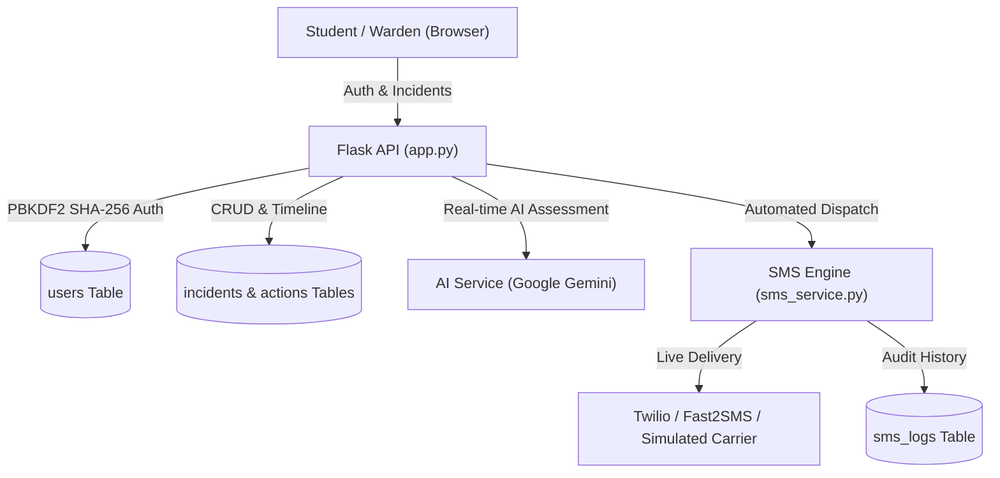

# HostelAid — Full Working Emergency Response System
### (Auth • SMS Alerts • AI Triage • SQLite Database)

A complete full-stack emergency response system with **User Authentication**, **Automated SMS Emergency Alerts**, **Persistent SQLite Storage**, and **Live AI Triage (Google Gemini & OpenAI)**.

---

## What's Included



---

## 1. User Data & Authentication System

### Seeded Demo Accounts (1-Click Login on UI)
| Role | Email | Password | Details |
|---|---|---|---|
| **Hostel Warden** | `warden@hostel.edu` | `warden123` | Aarav Sharma (Block A Supervisor) |
| **Resident Student** | `student@hostel.edu` | `student123` | Rahul Verma (Block A · Room 204) |
| **Medical Responder** | `doctor@hostel.edu` | `doctor123` | Dr. Meera Joshi (Health Center) |

### Features:
- **PBKDF2 SHA-256 Password Hashing**: Zero external library dependency, cryptographic salt generation.
- **Signed Bearer Tokens**: 7-day secure HMAC sessions.
- **Resident Profile Management**: Tracks Hostel Block, Room Number, Emergency Contact (Parent/Guardian phone), and Medical Notes (allergies, blood group).
- **Auto-population**: When a logged-in student reports an emergency, their name, room number, callback phone, and location are automatically populated.

---

## 2. Automated SMS Alert System (`sms_service.py`)

### Automated Triggers:
1. **When an Incident is Created**: An automated emergency SMS alert is immediately broadcast to all on-duty wardens and emergency responders:
   ```
   [HOSTELAID ALERT] High Medical Incident #HA-1043 reported at Block A · Floor 1. Title: Severe allergic reaction... Immediate response required.
   ```
2. **When Status Changes to "Responding"**: An automated SMS notification is sent to the student callback number:
   ```
   [HOSTELAID] Help is en route for Incident #HA-1043. Responder Aarav Sharma is on the way. Stay calm and safe.
   ```
3. **When a Responder is Assigned**: SMS alert sent to the assigned responder with incident location and summary.

### SMS Providers Supported:
- **High-Fidelity Simulation Mode (Default)**: Saves all dispatches with timestamps and delivery status directly to the `sms_logs` table in SQLite — perfect for testing without incurring carrier costs.
- **Twilio SMS Gateway**: Configure Twilio Account SID, Auth Token, and Sender Phone Number in the Settings modal or `.env`.
- **Fast2SMS**: Direct SMS gateway support for Indian phone numbers without DLT requirements.

---

## 3. Real-Time AI Triage (`ai_service.py`)
- Powered by **Google Gemini** (`gemini-1.5-flash`, `gemini-2.0-flash`) and **OpenAI**.
- Generates priority, best responder assignment, medical rationale, and **Immediate Bystander First-Aid Steps**.
- Built-in heuristic fallback so the app functions 100% even without an API key.

---

## Quick Start

1. Start the server (if not already running):
   ```bash
   python app.py
   ```
2. Open **`http://localhost:5000`** in your browser.
3. Click **"Sign In"** in the top bar and use the 1-click button for **Warden**, **Student**, or **Doctor**.
4. Test reporting an emergency & check the **"SMS Dispatches"** tab on the left to inspect outgoing broadcasts.
